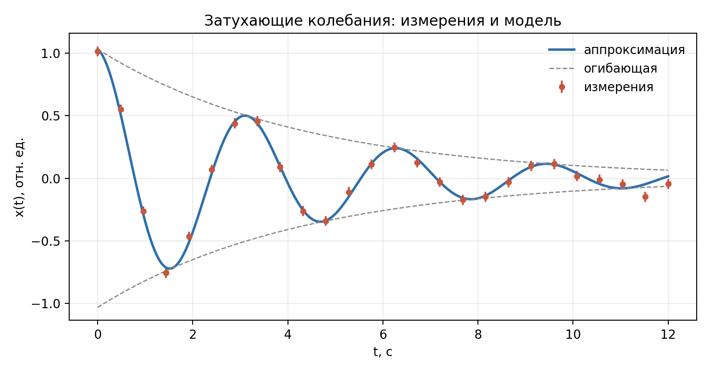

# P2. Страница-стресс-тест научного контента

Страница описывает обработку результатов модельного эксперимента:
измерение затухающих колебаний, аппроксимацию методом наименьших
квадратов и оценку коэффициента затухания.

## Модель затухающих колебаний {#eq-damped}

$$
x(t) = A\,e^{-\lambda t}\cos(\omega t + \varphi)
\tag{1}
$$

Из уравнения (1) следует, что логарифмический декремент затухания
связан с коэффициентом $\lambda$ и периодом колебаний $T$:

$$
\Lambda = \lambda T.
\tag{2}
$$

Ссылка на формулу (2) оформлена как перекрёстная ссылка на раздел
[«Результаты аппроксимации»](#fit-results).

## Таблица измерений

Таблица 1 — серии измерений (модельные данные, 26 точек на серию).

<table>
<caption>Таблица 1 — параметры серий измерений</caption>
<thead>
<tr>
  <th rowspan="2">Серия</th>
  <th colspan="2">Параметры установки</th>
  <th rowspan="2">λ, с⁻¹</th>
  <th rowspan="2">R²</th>
</tr>
<tr>
  <th>A, отн. ед.</th>
  <th>ω, рад/с</th>
</tr>
</thead>
<tbody>
<tr><td>A1</td><td>1,00</td><td>2,00</td><td>0,221 ± 0,006</td><td>0,994</td></tr>
<tr><td>A2</td><td>1,00</td><td>2,00</td><td>0,219 ± 0,007</td><td>0,991</td></tr>
<tr><td>A3</td><td>1,00</td><td>2,00</td><td>0,224 ± 0,005</td><td>0,996</td></tr>
</tbody>
</table>

## Результаты аппроксимации {#fit-results}

На рисунке 1 точками показаны измерения с погрешностями, сплошной
линией — аппроксимация моделью из формулы (1), штриховыми линиями —
огибающая $A e^{-\lambda t}$.



Интерактивная версия того же графика (Plotly, библиотека подключена
локально):

<iframe src="../plotly-damped.html" title="Интерактивный график Plotly"
        style="width:100%;height:460px;border:1px solid #ddd;border-radius:8px"></iframe>

## Двухколоночный блок

<div class="grid cards" markdown>

-   **Что измерялось**

    Амплитуда свободных затухающих колебаний при фиксированной
    начальной амплитуде. Погрешность единичного измерения — 0,04
    относительных единицы.

-   **Как обрабатывалось**

    Нелинейный метод наименьших квадратов (`scipy.optimize.curve_fit`),
    начальное приближение — по положению первых максимумов.

</div>

## Листинг расчётного кода

```python title="scripts/damped_fit.py" linenums="1"
import numpy as np
from scipy.optimize import curve_fit


def model(t, a, lam, om, ph):
    return a * np.exp(-lam * t) * np.cos(om * t + ph)


t = np.linspace(0, 12, 26)
x = model(t, 1.0, 0.22, 2.0, 0.0) + np.random.default_rng(1).normal(0, 0.04, t.size)
popt, pcov = curve_fit(model, t, x, p0=[1.0, 0.2, 2.0, 0.0])
perr = np.sqrt(np.diag(pcov))
print(f"lambda = {popt[1]:.3f} +/- {perr[1]:.3f} c^-1")
```

## Сноска и ссылка на другой раздел

Расчёт выполнен по методике, описанной в [ПР4](pr4.md#analysis)[^1].

[^1]: Полные таблицы и графики приведены в отчёте по практической
    работе № 1; здесь воспроизведён минимальный набор, необходимый
    для проверки вёрстки.

## Что проверялось

| Элемент | Реализация в MkDocs + Material |
|---|---|
| Нумерованная формула | `pymdownx.arithmatex` + MathJax, номер через `\tag` |
| Ссылка на формулу | ссылка на якорь раздела, проверяется при `--strict` |
| Таблица с `rowspan`/`colspan` | HTML-таблица в Markdown |
| Статический график | matplotlib, PNG в репозитории |
| Интерактивный график | Plotly, `include_plotlyjs=False`, JS локально |
| Листинг с подсветкой | `pymdownx.highlight`, `linenums` |
| Сноска | `footnotes` |
| Двухколоночный блок | `grid cards` темы Material |
